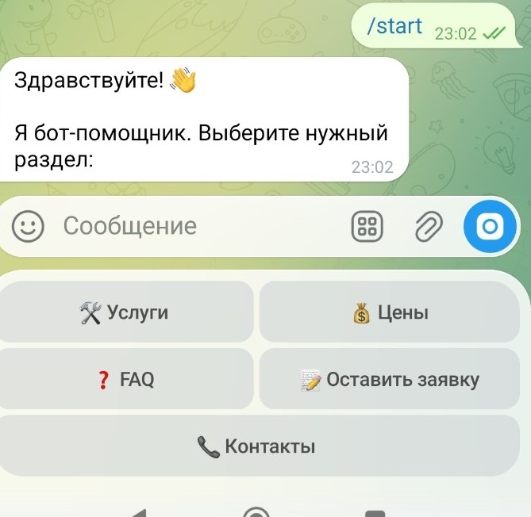
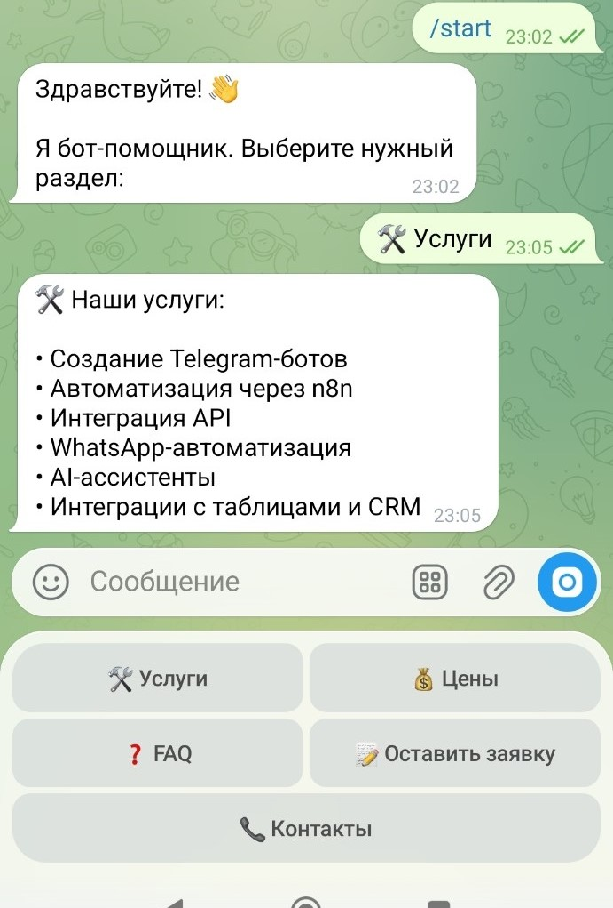
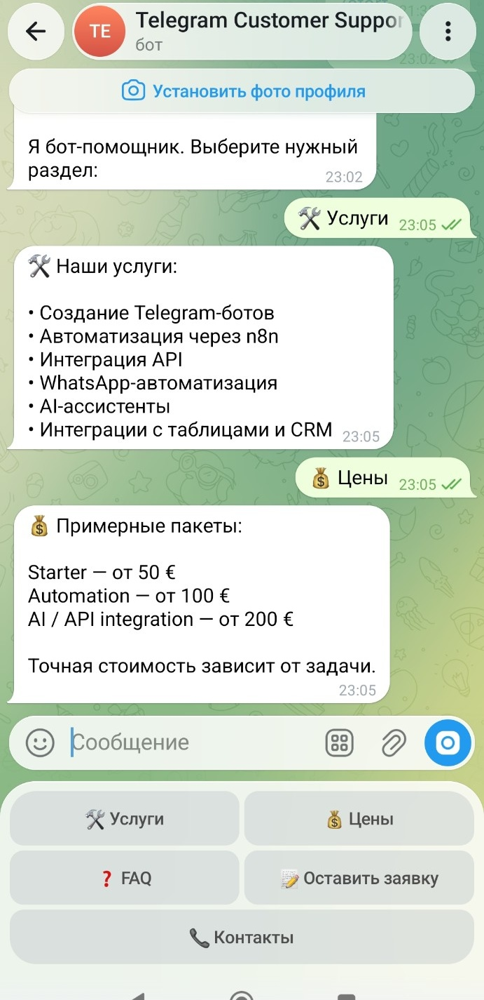
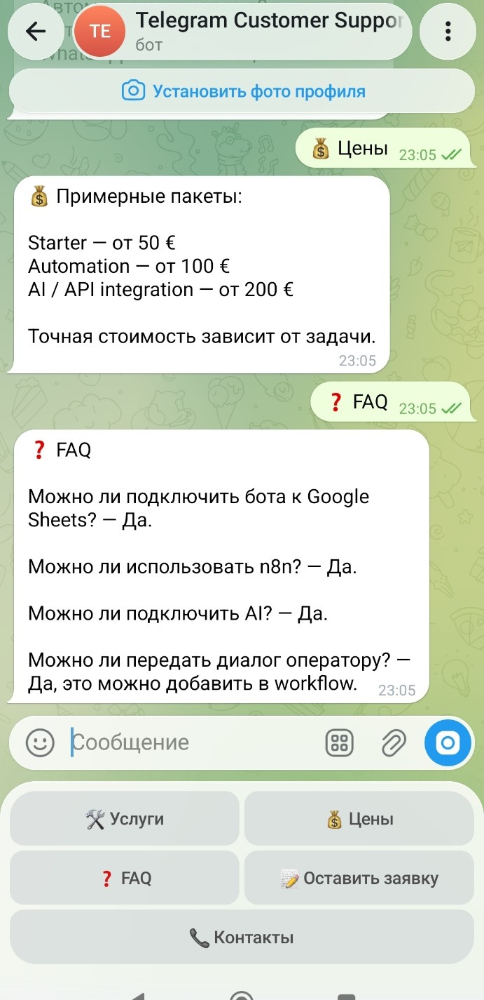
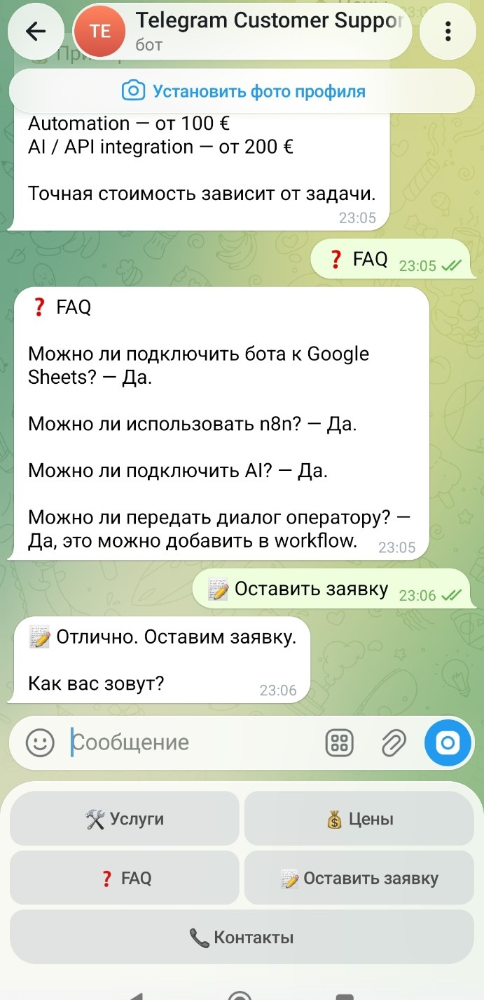
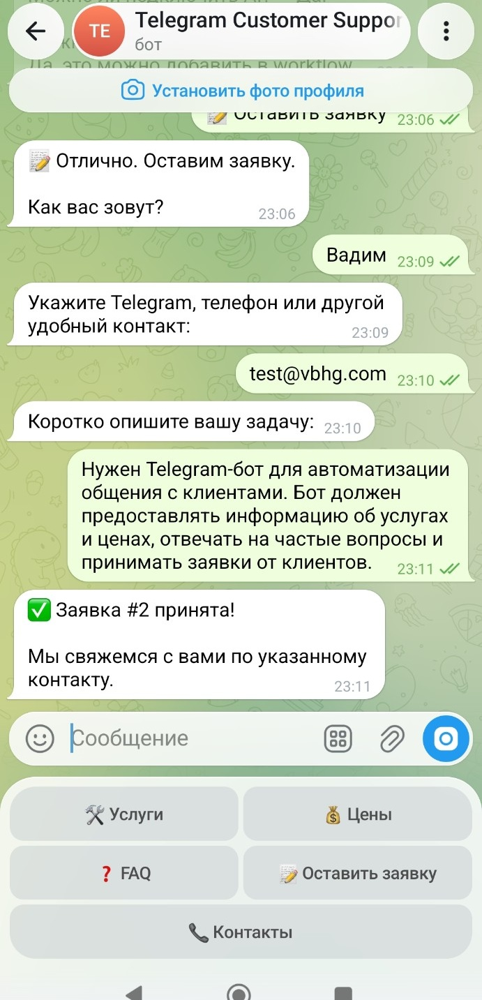

# Project #1 — Telegram Customer Support Bot

**Python · Telegram Bot API · SQLite**

## 🇷🇺 Русская версия

### О проекте

Telegram-бот для автоматизации базовой поддержки клиентов и первичного сбора заявок. Бот показывает пользователю меню, помогает ознакомиться с услугами, ценами и ответами на частые вопросы, а затем принимает заявку поэтапно.

### Основные возможности

- Команда `/start` и главное меню.
- Просмотр доступных услуг.
- Просмотр цен.
- Раздел FAQ с ответами на частые вопросы.
- Пошаговый сбор заявки: имя, контакт и описание задачи.
- Подтверждение принятия заявки с номером.
- Хранение данных приложения в SQLite.

### Пример пользовательского сценария

1. Пользователь запускает бота.
2. Открывает раздел услуг, цен или FAQ.
3. Выбирает отправку заявки.
4. Бот последовательно запрашивает имя, контакт и описание задачи.
5. Бот подтверждает приём заявки и показывает её номер.

В ручной проверке рабочей версии были проверены `/start`, разделы Services, Prices и FAQ, а также полный сценарий приёма заявки. Тестовая заявка была принята с подтверждением `Заявка #2 принята`.

### Технологии

- Python
- Telegram Bot API
- SQLite

### Скриншоты

1. [Главное меню](Project01_01_Start_Menu.jpg)
   
2. [Услуги](Project01_02_Services.jpg)
   
3. [Цены](Project01_03_Prices.jpg)
   
4. [FAQ](Project01_04_FAQ.jpg)
   
5. [Форма заявки](Project01_05_Lead_Form.jpg)
   
6. [Заявка принята](Project01_06_Request_Accepted.jpg)
   

### Технические материалы

Выбранные исходные файлы находятся в [`src/`](src/). В пакет включены `bot.py`, `requirements.txt`, `run.sh` и безопасный `.env.example`.

### Безопасность

- Рабочий Telegram-токен не включён.
- Реальный `.env` не включён.
- Локальная база SQLite с данными пользователей не включена.
- Для запуска необходимо создать собственную конфигурацию на основе `.env.example`.

### Статус

**Завершённый портфолио-проект.** Основные пользовательские сценарии и приём тестовой заявки проверены вручную.

---

## 🇬🇧 English Version

### About the Project

A Telegram bot that automates basic customer support and initial lead intake. It presents a menu, lets users review services, prices, and frequently asked questions, and then collects a lead step by step.

### Key Features

- `/start` command and main menu.
- Service listing.
- Price information.
- FAQ section.
- Step-by-step lead collection: name, contact details, and task description.
- Lead acceptance confirmation with a reference number.
- SQLite storage for application data.

### Example User Flow

1. The user starts the bot.
2. The user opens Services, Prices, or FAQ.
3. The user chooses to submit a request.
4. The bot asks for a name, contact details, and task description.
5. The bot confirms that the request was accepted and displays its number.

The working version was manually checked for `/start`, Services, Prices, and FAQ, as well as the complete lead-intake flow. A test request was accepted with the confirmation `Заявка #2 принята`.

### Technology Stack

- Python
- Telegram Bot API
- SQLite

### Screenshots

1. [Main menu](Project01_01_Start_Menu.jpg)
   
2. [Services](Project01_02_Services.jpg)
   
3. [Prices](Project01_03_Prices.jpg)
   
4. [FAQ](Project01_04_FAQ.jpg)
   
5. [Lead form](Project01_05_Lead_Form.jpg)
   
6. [Request accepted](Project01_06_Request_Accepted.jpg)
   

### Technical Materials

Selected source files are available in [`src/`](src/). The package includes `bot.py`, `requirements.txt`, `run.sh`, and a safe `.env.example`.

### Security

- The live Telegram bot token is excluded.
- The real `.env` file is excluded.
- The local SQLite database containing user data is excluded.
- Create your own configuration based on `.env.example` before running the bot.

### Status

**Completed portfolio project.** The main user flows and a test lead submission were manually verified.
