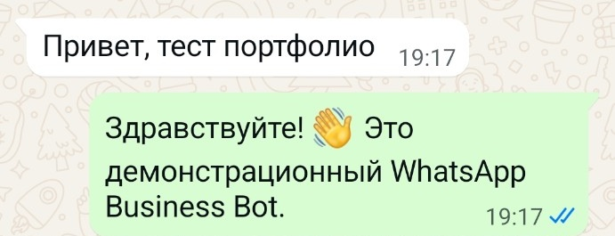
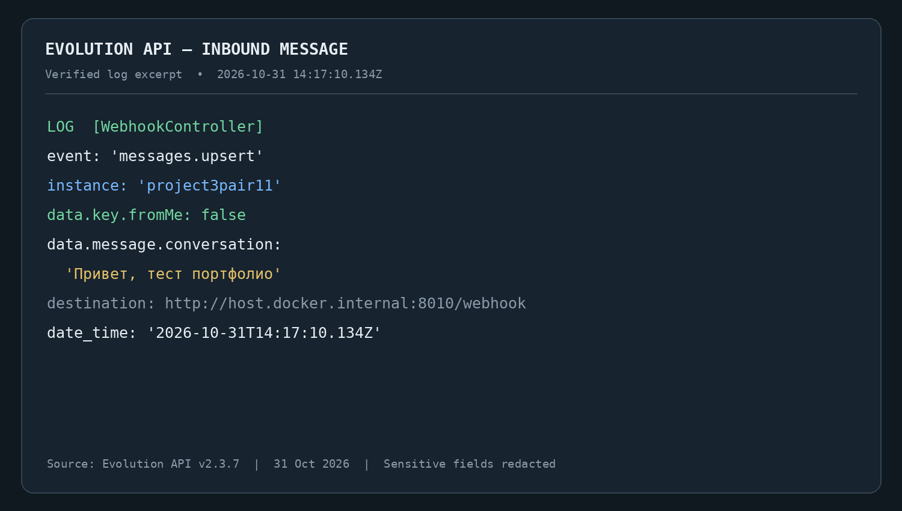
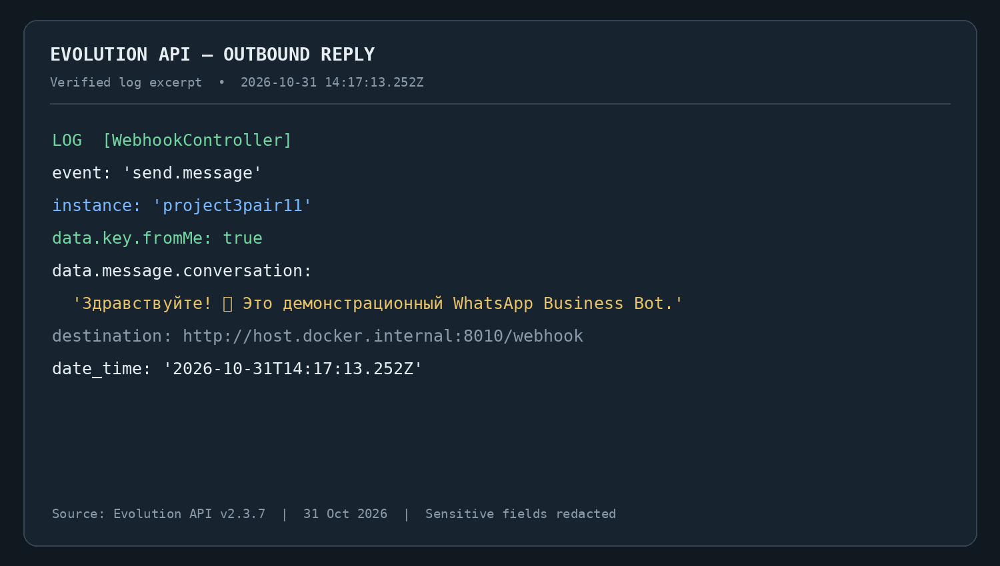

# Project #3 — WhatsApp Business Bot + Evolution API

**Status / Статус:** Completed portfolio project · Real WhatsApp end-to-end test verified  
**Languages / Языки:** Русский / English

## 🇷🇺 Русская версия

### О проекте

Демонстрационный WhatsApp Business Bot, построенный на **Python**, **FastAPI** и **Evolution API**. Бот принимает входящие сообщения WhatsApp через webhook, определяет намерение пользователя и отправляет автоматический текстовый ответ.

Проект разделяет HTTP/webhook-слой, логику диалога и клиент Evolution API. Логика бота реализована отдельно от FastAPI и может тестироваться независимо от реального WhatsApp.

### Основные возможности

- Приём WhatsApp-событий через `POST /webhook`.
- Проверка работоспособности через `GET /health`.
- Обработка событий Evolution API v2, включая `messages.upsert`.
- Извлечение текста из входящих сообщений.
- Определение намерения и подготовка ответа в отдельном Python-модуле.
- Отправка текстовых сообщений через Evolution API `sendText`.
- Защита от зацикливания: сообщения с `fromMe: true` не обрабатываются как новые входящие.
- Проверка webhook-секрета и разрешённых экземпляров.
- Обработка сетевых ошибок, тайм-аутов и неожиданных ответов API.
- Автоматические тесты без подключения реального WhatsApp.

### Архитектура

```text
WhatsApp user
     |
     v
Evolution API
     | messages.upsert
     v
FastAPI webhook (/webhook)
     |
     v
Webhook parser
     |
     v
Bot logic (intent -> reply)
     |
     v
Evolution API client
     | sendText
     v
WhatsApp user
```

### Основные модули

- `app/main.py` — FastAPI-приложение, маршруты, аутентификация и защита от повторной обработки собственных сообщений.
- `app/webhook.py` — разбор входящих webhook payloads Evolution API.
- `app/bot.py` — определение намерения и подготовка ответа; логика не зависит от HTTP.
- `app/evolution_api.py` — асинхронный HTTP-клиент для Evolution API.
- `app/config.py` — типизированная конфигурация из переменных окружения.

### Технологии

| Компонент | Технология |
|---|---|
| Язык | Python 3.11+ |
| Web framework | FastAPI |
| ASGI server | Uvicorn |
| HTTP client | HTTPX |
| Configuration | pydantic-settings |
| WhatsApp gateway | Evolution API v2.3.7 |
| Messaging library | Baileys 7.0.0-rc.9 |
| Containers | Docker, Docker Compose |
| Supporting services | PostgreSQL, Redis |
| Tests | pytest, FastAPI TestClient, HTTPX MockTransport |

### Пример работы

Входящее сообщение:

```text
Привет
```

Автоматический ответ:

```text
Здравствуйте! 👋 Это демонстрационный WhatsApp Business Bot.
```

### Результаты реального E2E-тестирования

**31 октября 2026 — повторный реальный тест после повторного запуска приложения.**

- Второе устройство отправило сообщение `Привет, тест портфолио`.
- Evolution API получил событие `messages.upsert` для экземпляра `project3pair11`.
- Входящее сообщение имело `fromMe: false`.
- FastAPI обработал webhook, бот определил приветствие и подготовил ответ.
- Evolution API зарегистрировал исходящее событие `send.message` с `fromMe: true`.
- Автоматический ответ появился в WhatsApp на втором устройстве.
- Входящее и исходящее события разделяли около трёх секунд по логам; получение ответа подтверждено в WhatsApp.

Ранее, 4 октября 2026 года, также был выполнен REAL E2E PASS с фактической доставкой ответа примерно за две секунды.

### Скриншоты

1. **WhatsApp — реальный диалог:** [открыть скриншот](screenshots/01_WhatsApp_E2E.jpg)

   

2. **Evolution API — входящее событие `messages.upsert`, `fromMe: false`:** [открыть скриншот](screenshots/02_Evolution_Inbound.jpg)

   

3. **Evolution API — исходящее событие `send.message`, `fromMe: true`:** [открыть скриншот](screenshots/03_Evolution_Outbound.jpg)

   

### Тестирование

Автоматический набор тестов проекта ранее завершился результатом **113 passed, 1 warning**. Отдельно выполнен реальный E2E-тест с двумя WhatsApp-устройствами и подтверждённым получением автоматического ответа.

### Технические материалы

- [`src/`](src/) — выбранные исходные файлы приложения и тесты.
- [`docs/REAL_E2E_TEST_REPORT.md`](docs/REAL_E2E_TEST_REPORT.md) — отчёт реального E2E-тестирования.
- [`src/config/.env.example`](src/config/.env.example) — пример конфигурации без рабочих секретов.

### Безопасность

- Реальные `.env` и API credentials не входят в публичные материалы.
- API keys, webhook secrets и персональные идентификаторы не должны публиковаться.
- Публичные скриншоты подготовлены с сокрытием чувствительных полей.
- Локальные базы данных, журналы с персональными данными и файлы с секретами исключены из публичного пакета.

### Статус проекта

**Завершённый портфолио-проект.** Реальный обмен сообщениями WhatsApp через Evolution API и FastAPI проверен end to end: входящее событие, обработка ботом, отправка ответа и получение ответа на втором устройстве подтверждены.

---

## 🇬🇧 English Version

### About the Project

A demonstration WhatsApp Business Bot built with **Python**, **FastAPI**, and **Evolution API**. The bot receives incoming WhatsApp messages through a webhook, detects the user's intent, and sends an automated text reply.

The project separates the HTTP/webhook layer, conversation logic, and Evolution API client. Bot logic is independent of FastAPI and can be tested without a live WhatsApp connection.

### Features

- Receives WhatsApp events through `POST /webhook`.
- Health check endpoint at `GET /health`.
- Parses Evolution API v2 events, including `messages.upsert`.
- Extracts text from incoming messages.
- Detects intent and generates replies in a separate Python module.
- Sends text messages through Evolution API `sendText`.
- Prevents reply loops by ignoring messages marked `fromMe: true`.
- Validates the webhook secret and allowed instances.
- Handles network errors, timeouts, HTTP errors, and unexpected API responses.
- Includes automated tests that do not require a live WhatsApp account.

### Architecture

```text
WhatsApp user
     |
     v
Evolution API
     | messages.upsert
     v
FastAPI webhook (/webhook)
     |
     v
Webhook parser
     |
     v
Bot logic (intent -> reply)
     |
     v
Evolution API client
     | sendText
     v
WhatsApp user
```

### Core Modules

- `app/main.py` — FastAPI application, routes, authentication, and loop prevention.
- `app/webhook.py` — Evolution API webhook payload parsing.
- `app/bot.py` — intent detection and reply generation, independent of HTTP.
- `app/evolution_api.py` — asynchronous Evolution API HTTP client.
- `app/config.py` — typed environment-based configuration.

### Technology Stack

| Component | Technology |
|---|---|
| Language | Python 3.11+ |
| Web framework | FastAPI |
| ASGI server | Uvicorn |
| HTTP client | HTTPX |
| Configuration | pydantic-settings |
| WhatsApp gateway | Evolution API v2.3.7 |
| Messaging library | Baileys 7.0.0-rc.9 |
| Containers | Docker, Docker Compose |
| Supporting services | PostgreSQL, Redis |
| Testing | pytest, FastAPI TestClient, HTTPX MockTransport |

### Example Interaction

Incoming message:

```text
Привет
```

Automated reply:

```text
Здравствуйте! 👋 Это демонстрационный WhatsApp Business Bot.
```

### Real End-to-End Verification

**31 October 2026 — repeat live test after restarting the application.**

- A second device sent `Привет, тест портфолио`.
- Evolution API received a `messages.upsert` event for instance `project3pair11`.
- The inbound message was marked `fromMe: false`.
- FastAPI processed the webhook, and the bot generated a greeting reply.
- Evolution API recorded an outbound `send.message` event marked `fromMe: true`.
- The automated reply appeared in WhatsApp on the second device.
- The inbound and outbound events were approximately three seconds apart in the logs; receipt of the reply was confirmed in WhatsApp.

An earlier REAL E2E PASS was also completed on 4 October 2026, with the reply delivered in approximately two seconds.

### Screenshots

1. **WhatsApp — real conversation:** [view screenshot](screenshots/01_WhatsApp_E2E.jpg)

   

2. **Evolution API — inbound `messages.upsert` event, `fromMe: false`:** [view screenshot](screenshots/02_Evolution_Inbound.jpg)

   

3. **Evolution API — outbound `send.message` event, `fromMe: true`:** [view screenshot](screenshots/03_Evolution_Outbound.jpg)

   

### Testing

The project's automated test suite previously completed with **113 passed, 1 warning**. A separate live end-to-end test was performed using two WhatsApp devices, with receipt of the automated reply confirmed.

### Technical Materials

- [`src/`](src/) — selected application source files and tests.
- [`docs/REAL_E2E_TEST_REPORT.md`](docs/REAL_E2E_TEST_REPORT.md) — real end-to-end test report.
- [`src/config/.env.example`](src/config/.env.example) — configuration example without live secrets.

### Security

- Real `.env` files and API credentials are excluded from public materials.
- API keys, webhook secrets, and personal identifiers must not be published.
- Public screenshots have been prepared with sensitive fields redacted.
- Local databases, logs containing personal data, and secret-bearing files are excluded from the public package.

### Project Status

**Completed portfolio project.** The real WhatsApp message flow through Evolution API and FastAPI has been verified end to end: the inbound event, bot processing, outbound reply, and receipt on the second device were confirmed.
