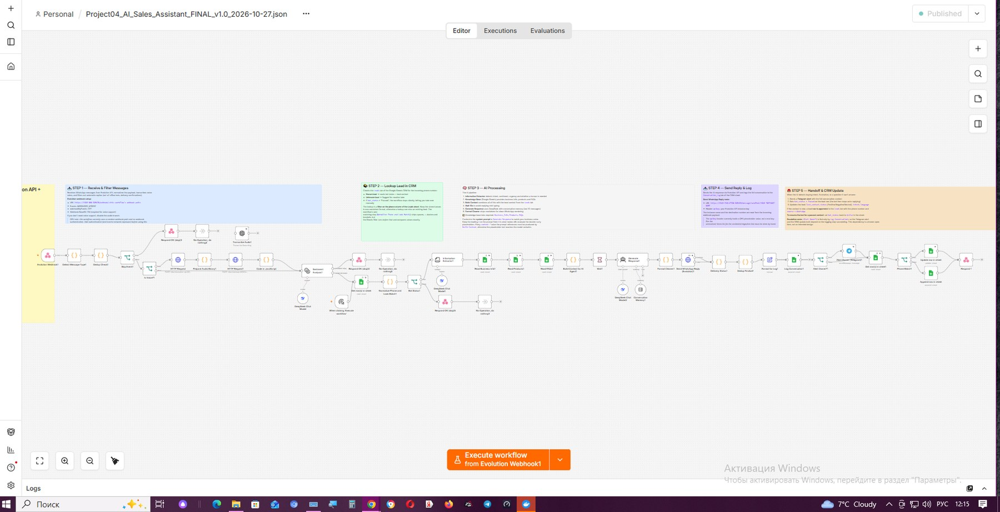
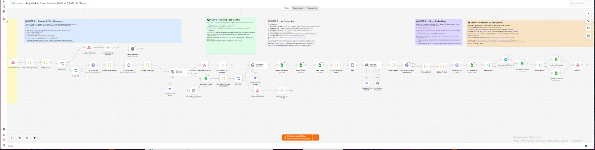
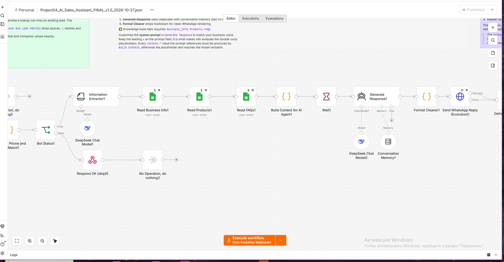
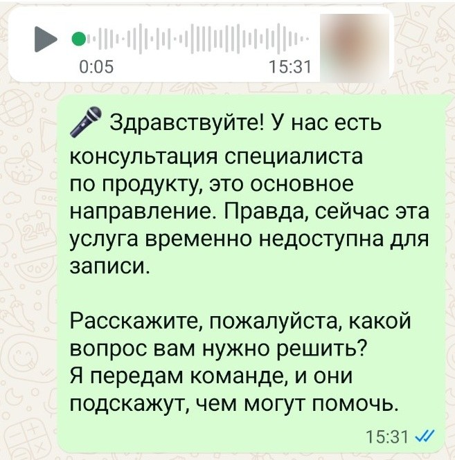
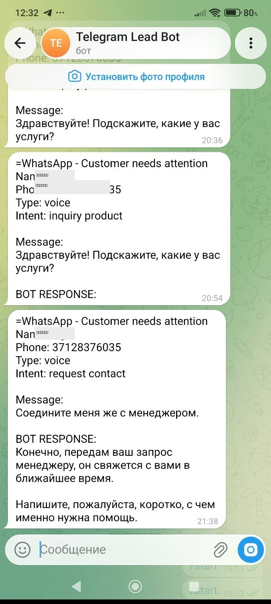
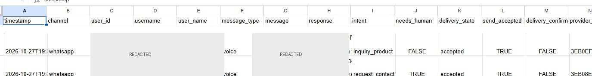
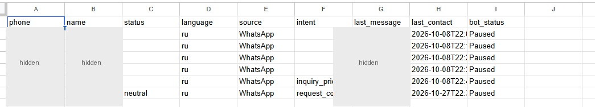
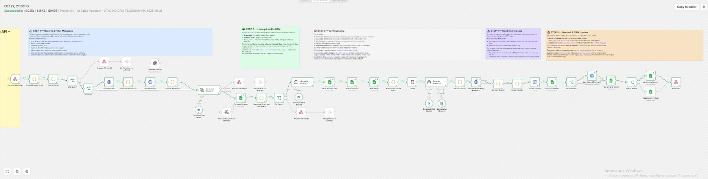

# Project #4 — AI Sales Assistant

**AI-assisted WhatsApp support · n8n workflow automation · Google Sheets CRM · Telegram manager alerts**

**Status / Статус:** Portfolio project — real end-to-end scenarios verified  
**Documentation / Документация:** Русский / English

---

## 🇷🇺 Русская версия

### О проекте

AI Sales Assistant — демонстрационный AI-ассистент для обработки входящих обращений клиентов в WhatsApp. n8n управляет процессом, DeepSeek анализирует сообщения и помогает формировать ответы, Google Sheets используется как CRM и журнал диалогов, а Telegram доставляет уведомления менеджеру, когда требуется человеческое вмешательство.

**Важно:** в показанной конфигурации WhatsApp — канал общения с клиентом, а Telegram — канал уведомлений менеджера. Это не два клиентских канала.

### Что умеет демонстрационная система

- Принимать входящие сообщения WhatsApp, включая проверенный голосовой сценарий.
- Определять тип и намерение обращения.
- Получать сведения о компании, продуктах и FAQ из Google Sheets.
- Формировать ответ с помощью DeepSeek и контекста диалога.
- Отправлять подготовленный ответ клиенту через Evolution API.
- Записывать лиды и историю общения в Google Sheets.
- Передавать менеджеру уведомления в Telegram, когда требуется помощь человека.
- Использовать SQLite для защиты от повторной обработки событий.

### Архитектура

1. Клиент отправляет сообщение в WhatsApp.
2. Evolution API передаёт событие в webhook n8n.
3. Workflow фильтрует событие и проверяет статус обработки.
4. CRM lookup и AI-узлы получают контекст и определяют намерение.
5. DeepSeek формирует ответ на основе доступной информации.
6. Workflow отправляет ответ через Evolution API и записывает результат в CRM.
7. При необходимости отдельная ветка отправляет менеджеру уведомление в Telegram.

### Демонстрация / Demo Video

[▶ Смотреть демонстрацию проекта / Watch project demo](Project04_AI_Sales_Assistant_Demo_FINAL_v5.mp4)

### Скриншоты

Ниже — реальные снимки интерфейса и проверенных сценариев. Персональные данные на CRM- и Telegram-снимках скрыты.

**Общая архитектура и этапы workflow**

**AI-обработка**

**Каналы и CRM**

**Успешное исполнение**

### Проверенные результаты

- Реальный WhatsApp end-to-end сценарий: входящее сообщение с отдельного аккаунта прошло через интеграцию, автоматический ответ был получен отправителем.
- Проверен голосовой сценарий WhatsApp с автоматическим ответом.
- Проверена запись информации о лидах и сообщений в Google Sheets.
- Проверена отправка Telegram-уведомления менеджеру при обращении, требующем внимания.
- На опубликованном снимке показано успешное исполнение n8n от 27 октября 2026 года.

**О статусах доставки:** принятие запроса API и подтверждённая доставка — разные состояния. Статус `PENDING` сам по себе не означает, что сообщение доставлено. Факт получения ответа в реальном E2E-сценарии подтверждался отдельно.

### Технологии

- n8n — workflow automation
- Evolution API — WhatsApp integration
- DeepSeek — AI message processing
- Google Sheets — CRM and conversation log
- SQLite — message deduplication
- Telegram Bot API — manager notifications
- Docker — containerized environment

### Материалы проекта

- `README-TECHNICAL.md` — техническое описание архитектуры и проверок.
- `SETUP.md` — общая инструкция по подготовке отдельного тестового окружения.
- `workflow/Project04_AI_Sales_Assistant_REDACTED_TEMPLATE.json` — очищенный демонстрационный экспорт workflow.
- `screenshots/` — изображения интерфейса и проверенных сценариев.

Демонстрационный JSON не является готовым production-развёртыванием. Для использования в другом окружении необходимо самостоятельно настроить credentials, webhook URLs, таблицы и параметры интеграций.

### Безопасность

Публичные материалы не должны содержать реальные credentials, токены, номера клиентов, личные переписки, базы данных или рабочие логи. Перед запуском используйте собственные учётные данные и отдельное тестовое окружение.

---

## 🇬🇧 English Version

### About

AI Sales Assistant is a demonstration AI assistant for handling incoming customer inquiries through WhatsApp. n8n orchestrates the workflow, DeepSeek analyzes messages and helps generate replies, Google Sheets serves as a lightweight CRM and conversation log, and Telegram is used to notify a manager when human intervention is needed.

**Important:** in the demonstrated setup, WhatsApp is the customer-facing channel, while Telegram is the manager-notification channel. They are not two customer-facing channels.

### Demonstrated capabilities

- Receives incoming WhatsApp messages, including a verified voice-message scenario.
- Identifies message type and customer intent.
- Retrieves business information, products, and FAQs from Google Sheets.
- Generates replies using DeepSeek and conversation context.
- Sends replies to customers through Evolution API.
- Stores lead information and conversation history in Google Sheets.
- Sends Telegram alerts to a manager when human assistance is required.
- Uses SQLite to prevent duplicate event processing.

### Architecture

1. A customer sends a WhatsApp message.
2. Evolution API forwards the event to an n8n webhook.
3. The workflow filters the event and checks processing status.
4. CRM lookup and AI nodes retrieve context and identify intent.
5. DeepSeek generates a response using the available information.
6. The workflow sends the reply through Evolution API and logs the result in the CRM.
7. When required, a separate branch sends a manager notification through Telegram.

### Screenshots

These are real interface captures and verified scenarios. Personal data in CRM and Telegram screenshots has been redacted.

**Workflow architecture and stages**

**AI processing**

**Messaging and CRM**

**Successful execution**

### Verified Results

- A real WhatsApp end-to-end scenario was verified: an incoming message from a separate account passed through the integration and the sender received an automated reply.
- A WhatsApp voice-message scenario with an automated response was verified.
- Lead and message logging in Google Sheets was verified.
- Telegram manager notification for an inquiry requiring attention was verified.
- The included execution screenshot shows a successful n8n run dated October 27, 2026.

**Delivery status note:** API acceptance and confirmed delivery are different states. A `PENDING` status alone does not prove delivery. Receipt of the automated reply in the real end-to-end scenario was verified separately.

### Technology stack

- n8n — workflow automation
- Evolution API — WhatsApp integration
- DeepSeek — AI message processing
- Google Sheets — CRM and conversation log
- SQLite — message deduplication
- Telegram Bot API — manager notifications
- Docker — containerized environment

### Project materials

- `README-TECHNICAL.md` — technical architecture and verification notes.
- `SETUP.md` — general guide for preparing a separate test environment.
- `workflow/Project04_AI_Sales_Assistant_REDACTED_TEMPLATE.json` — redacted demonstration workflow export.
- `screenshots/` — interface captures and verified scenarios.

The demonstration JSON is not a ready-to-run production deployment. Credentials, webhook URLs, spreadsheets, and integration settings must be configured for a separate environment.

### Security

Public materials must not contain live credentials, tokens, customer phone numbers, private conversations, databases, or runtime logs. Use your own credentials and a separate test environment before running the workflow.

---

*Portfolio project demonstrating AI-assisted messaging, workflow automation, CRM logging, manager escalation, and end-to-end verification.*
